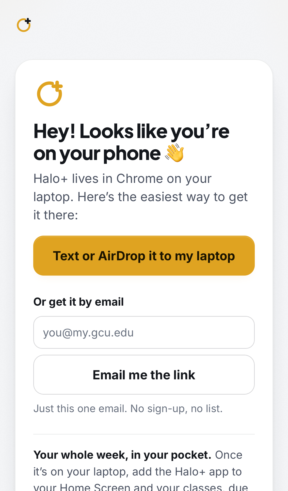
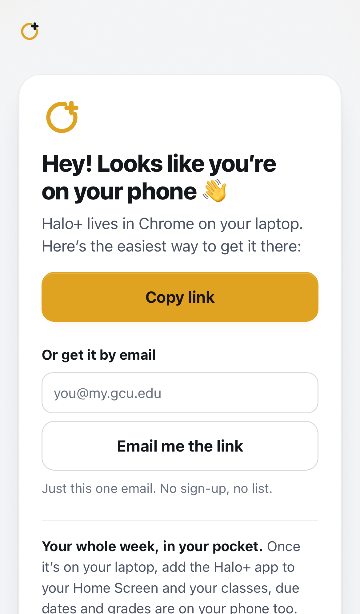
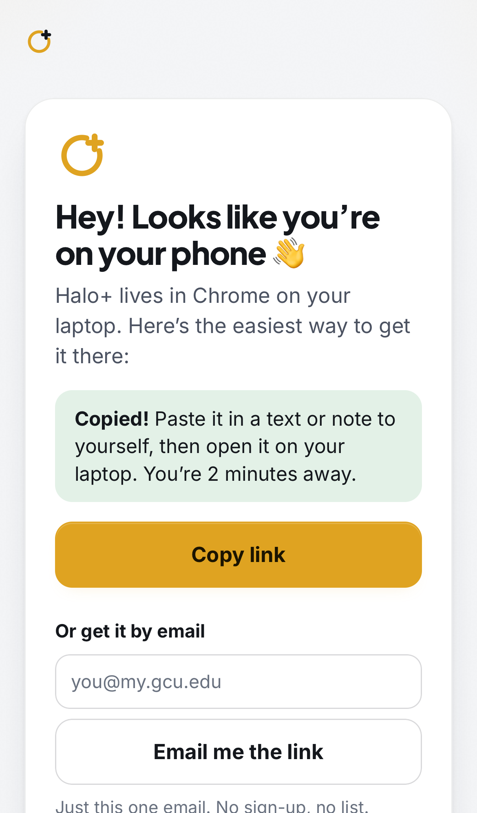
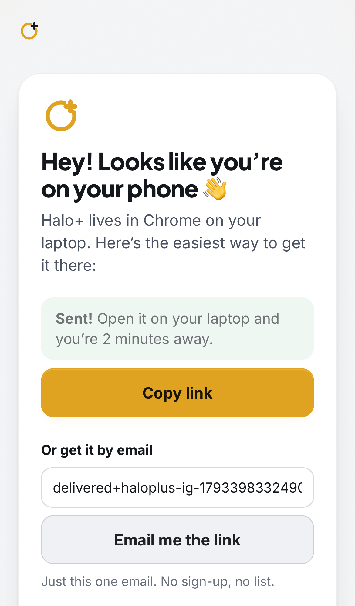
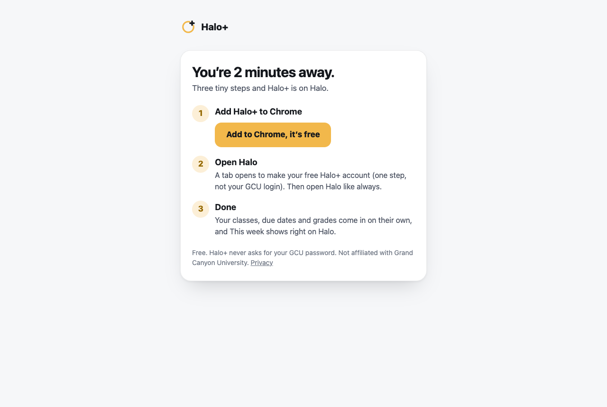
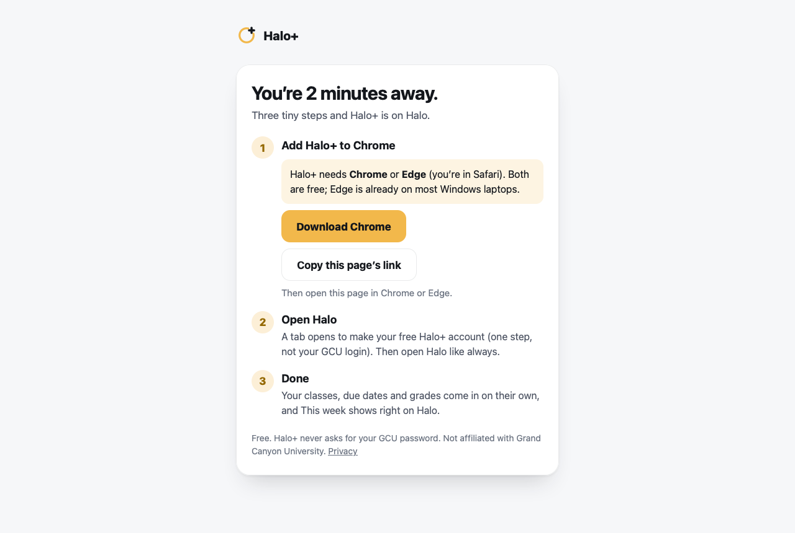
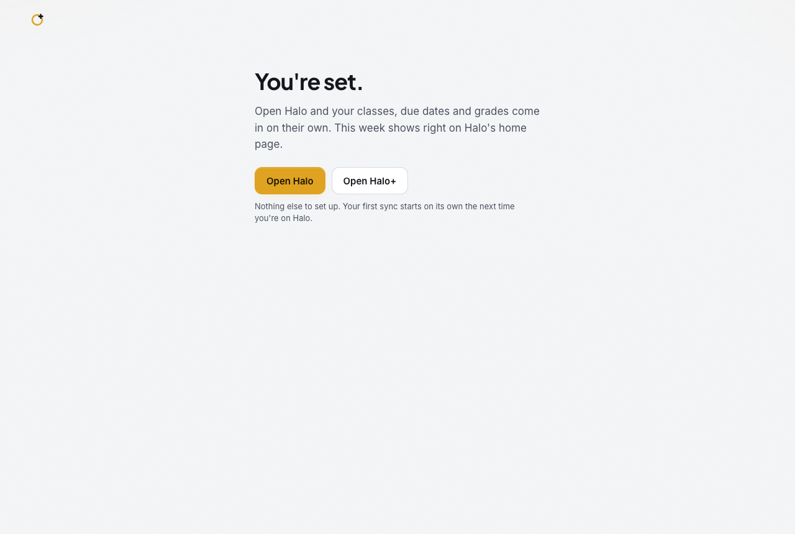
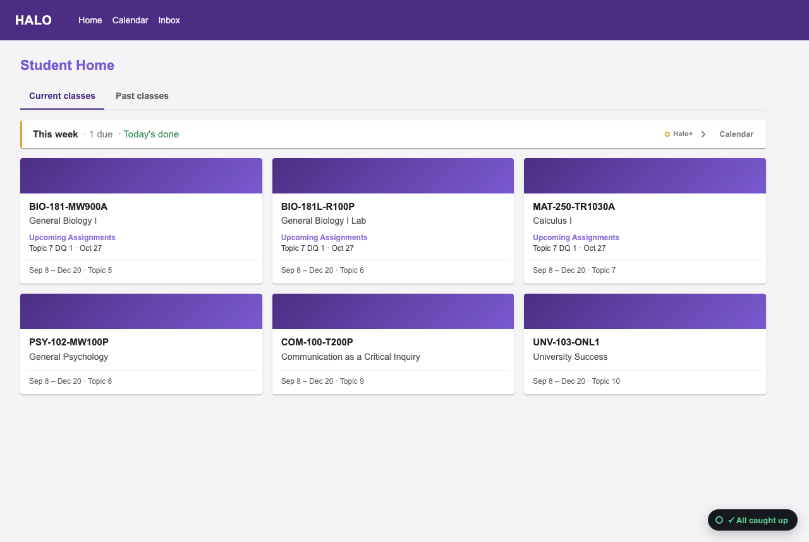
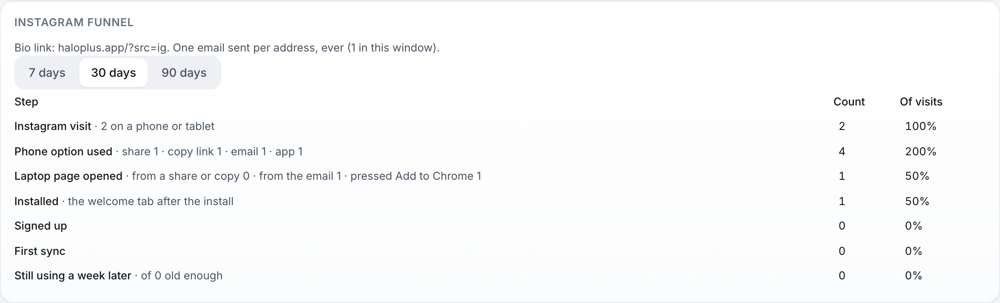

# The Instagram path (Loop 294, 2026-10-30)

Most Instagram visitors open haloplus.app on their phone, where the Chrome extension can't go. This is the path from the
bio link to "This week" on Halo, built to be friendly, short and counted.

**Bio link:** `https://haloplus.app/?src=ig`
(`?ref=ig` works too. `src=` is the tag because `ref=` is already used for invite codes.)

## What a phone visitor sees

The phone screen only shows for a signed-out visitor on a phone or tablet. It's part of the page itself, so it appears
on first paint, even before the app's code loads on cell data. Signed-in visitors and desktop visitors see exactly what
they see today. Desktop was checked against the live site: 0 pixels changed across the whole page.

| iPhone Safari | Instagram's in-app browser | After "Copy link" | After "Email me the link" |
|---|---|---|---|
|  |  |  |  |

The screen, from the top:
- The Halo+ mark and "Hey! Looks like you're on your phone 👋" ("…on your iPad" on an iPad).
- "Halo+ lives in Chrome on your laptop. Here's the easiest way to get it there:"
- **The share button.** It says "Text or AirDrop it to my laptop" on iPhone and "Send it to my laptop" on Android. It
  opens the phone's share sheet with the laptop page link. Where sharing isn't supported, it becomes **"Copy link"**.
- **"Or get it by email".** One field and an "Email me the link" button, with "Just this one email. No sign-up, no
  list."
- **"Your whole week, in your pocket."** One line saying the Halo+ app comes to the Home Screen once it's on the laptop,
  with a quiet "Make your account now" link.
- "Already have it on your laptop? **Sign in**"
- The calm reel: muted, looping, 540×960, 574 KB, starting fast.
- Then the landing page as always.

After either button the visitor gets a happy confirmation: "Sent! Open it on your laptop and you're 2 minutes away."
(or "Copied! Paste it in a text or note to yourself…").

### The one email

- It is sent through Resend by the new `laptop-link` function, with the subject "Open this on your laptop". It holds
  the laptop page link and the line "Just this one: we won't email you again, and we didn't keep your address."
- **Never twice.** Only a keyed hash of the address is stored, and the same address gets "Already sent!" with nothing
  sent.
- **Limits:** at most 8 a day from one IP and 400 a day in all.
- It is not a sign-up and not a list, and there are no follow-ups.

## Can a student do it all on their phone? Not well, today

- **Sign-up on a phone works** (email and password, no confirmation step).
- **Getting Halo data on a phone alone is the problem.** The only no-laptop path is a hand-made "😇 Sync Halo"
  bookmark, about 8 manual steps:
  - copy a code
  - bookmark a page
  - edit that bookmark and paste the code over its address
  - open Halo and run the bookmark
- **The server hand-off is off.** It is built but switched off by default, and without it the last step can mean
  copying a multi-MB export and pasting it back.
- **The record:** Loop 245 counted 7 phone sign-ups. 2 synced, both only after moving to a Mac; the other 5 got stuck
  in the bookmark steps.
- **Instagram's in-app browser can't do it at all.** It has no bookmarks and no Home Screen.

So the app is the "your whole week, in your pocket" line, not a third button.

What would make phone-only work:
1. **Turn the server hand-off on for everyone.** It's on the Admin switch and removes the copy-and-paste.
2. **Replace the bookmark steps with an iOS Shortcut** that runs on the Halo page, or eventually a Safari Web Extension
   (that one needs an App Store app).
3. **Tell Instagram's browser visitors to "Open in Safari" first** if they choose the phone path.
4. **Test the bookmark steps once on a real iPhone.** They have never been checked on real hardware.

## The walkthrough, timed

Fresh browsers throughout: WebKit (Safari's engine) at iPhone size, and a new Chrome profile on the laptop. The script
is `scripts/e2e-ig-path.mjs`.

| Where | Step | Time | Taps |
|---|---|---|---|
| Phone, Safari | Tap the bio link: the phone screen is there | 0.2 s | 1 |
| Phone, Safari | "Text or AirDrop it to my laptop", pick AirDrop or Messages, send | ~4 s | 3 |
| Phone, Instagram | Tap the bio link: the phone screen | 0.1 s | 1 |
| Phone, Instagram | "Copy link", paste into a text or note to yourself | ~6 s | 4 |
| Phone, Instagram | "Email me the link": type the address, send | ~8 s | 3 |
| Laptop, Chrome | Open the email, "Open Halo+ on my laptop": the laptop page | ~4 s | 2 |
| Laptop, Chrome | "Add to Chrome, it's free", then the Web Store's Add to Chrome and Add extension | ~9 s | 3 |
| Laptop, Chrome | The welcome tab opens by itself: "One step left" | 2.6 s | 0 |
| Laptop, Chrome | One-step sign-up: email, Continue, password, Create | ~10.5 s | 4 |
| Laptop, Chrome | "Open Halo": the first sync runs on its own | 14 s | 1 |
| Laptop, Chrome | This week shows on Halo | at once | 0 |

Total, with the share sheet: about **4 s and 4 taps on the phone**, then about **40 s and 10 clicks on the laptop**, plus
however long the text, AirDrop or email takes to arrive.

The "~" times include an allowance for a person choosing and typing. Everything else is measured.

On cell data (Slow 4G: 1.6 Mbps, 150 ms), the phone screen shows in 0.2 s, its buttons work by 3.3 s, and the reel is
playing by 3.8 s.

| Laptop page (Chrome) | Laptop page (Safari or Firefox) | Signed up | This week on Halo |
|---|---|---|---|
|  |  |  |  |

### Friction found by walking it, and fixed

1. **The phone card was covered by the landing's live demo**, and its Sign in link couldn't be tapped. Cause: a class
   name already used by a small phone mock-up on the landing.
2. **The first sync could be lost.** A student who reads the welcome tab for over a minute, signs up, and clicks
   "Open Halo" at once could leave before the extension had the account's key. The extension's script there only looks
   every 30 s after the first minute, so the first sync waited for the next Halo visit. The app now tells the extension
   the moment the key is written. This works with the extension already in the store, so no new version is needed. In
   the test the key arrives in 0.1 s and the first sync lands 14 s after "Open Halo".
3. **The laptop page's button read "Add to Chrome , it's free"**, with a stray gap before the comma.
4. **The "needs Chrome or Edge" note broke onto five lines.**
5. **The source tag could be lost or misread.** The welcome tab's `src=store` would have overwritten the Instagram tag,
   and `?ref=ig` would have been read as an invite code. Now Instagram is kept through to the account, and the test
   account's source reads "ig".
6. **On the phone screen, the header's "Try it now" competed with the two buttons**, so it is hidden there.

Not checkable from here:
- the real Instagram app on a real iPhone (tested with Safari's engine, Instagram's user agent and no share sheet)
- the Web Store's own two install dialogs
- whether the email lands in a GCU inbox (it was sent once to Resend's test inbox)

## Measured in Admin: the Instagram funnel

The steps, in order (`admin_ig_funnel`):
1. Instagram visit
2. Phone option used (share · copy link · email · app)
3. Laptop page opened (from a share or copy, or from the email, and whether Add to Chrome was pressed)
4. Installed (the welcome tab after the install)
5. Signed up
6. First sync
7. Still using a week later

Steps before sign-up are counted once per browser, with a random id kept only in that browser. Account steps count real
students only. The source travels phone → laptop page → welcome tab → account on the site's own storage and the link's
tag, with no cookies and no third parties.

## Saved DM replies

**"Does it work on iPhone?"**
> Yes! 🙌 Halo+ lives in Chrome on your laptop, and once it's set up there your whole week is on your iPhone too (add it
> to your Home Screen). Tap the link in our bio on your phone and you can text, AirDrop or email the laptop link to
> yourself in one tap.

**"Is it free?"**
> Yep, free! Everything on Halo is free: what's next on every class, one calendar, search, the check-off. There's an
> optional Max plan ($0.99/mo) that reads announcements for hidden due dates, and you get it free for your first 7 days
> of use. No card needed.

**"Is it safe?"**
> Totally fair question. Halo+ never asks for your GCU password: it reads Halo from your own browser while you're
> signed in, the same things you can see. Your data is never sold or shared, and you can delete it any time. It's an
> independent tool made by a GCU student (not affiliated with GCU).
